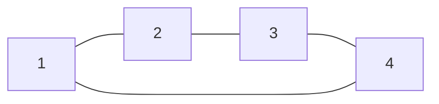
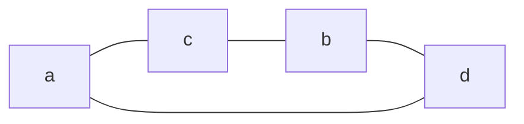
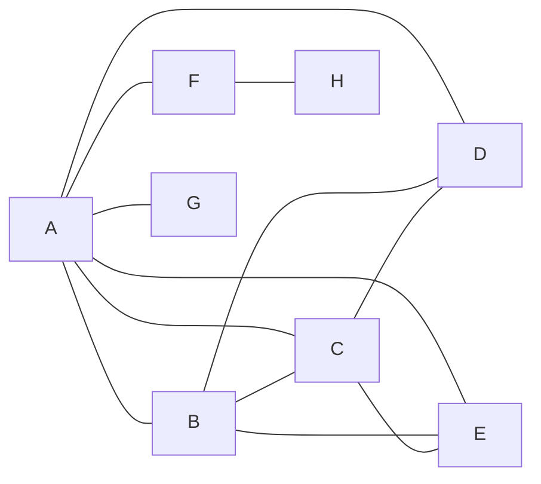

# Material do Estudante — Desafios 5 e 7

**Estrutura de Dados II | Unidade III — Grafos | Profa. Kadidja Valéria**

**Nome:** Maycon · **Turma:** Ciencia da computação - D1 · **Data:** 26/10/2026

---

## Desafio 5 — Isomorfismo

Os dois grafos do enunciado são:

- **G:** V = {1, 2, 3, 4}; E = {(1,2), (2,3), (3,4), (4,1)}
- **H:** V = {a, b, c, d}; E = {(a,c), (c,b), (b,d), (d,a)}

**Grafo G**

**Grafo H**

### 1. Ordem e tamanho

A ordem é o número de vértices e o tamanho é o número de arestas.

| Grafo | Ordem \|V\| | Tamanho \|E\| |
|:-----:|:-----------:|:-------------:|
| G     | 4           | 4             |
| H     | 4           | 4             |

Os dois grafos têm ordem 4 e tamanho 4, então esse primeiro requisito para o isomorfismo é satisfeito.

### 2. Graus dos vértices e sequência de graus

Contei quantas arestas incidem em cada vértice.

- **G:** grau(1) = 2 (arestas com 2 e 4); grau(2) = 2 (com 1 e 3); grau(3) = 2 (com 2 e 4); grau(4) = 2 (com 3 e 1).
- **H:** grau(a) = 2 (com c e d); grau(b) = 2 (com c e d); grau(c) = 2 (com a e b); grau(d) = 2 (com b e a).

**Sequência de graus de G:** (2, 2, 2, 2)  
**Sequência de graus de H:** (2, 2, 2, 2)

As sequências são iguais. Conferindo com o Teorema do Aperto de Mãos: 2 + 2 + 2 + 2 = 8 = 2 × 4 arestas, tanto em G quanto em H.

### 3. Correspondência entre os vértices

Como todos os vértices têm grau 2, os dois grafos são ciclos de comprimento 4. Para achar a correspondência, percorri o ciclo de G (1 → 2 → 3 → 4 → 1) e o ciclo de H (a → c → b → d → a), associando os vértices na ordem em que aparecem. A função f: V(G) → V(H) ficou assim:

| Vértice em G | Correspondente em H |
|:------------:|:-------------------:|
| 1            | a                   |
| 2            | c                   |
| 3            | b                   |
| 4            | d                   |

A função f é bijetora: cada vértice de G tem um correspondente diferente em H e nenhum vértice de H ficou de fora.

### 4. Verificação aresta por aresta

| Aresta de G | Imagem pela correspondência | Existe em H?        |
|:-----------:|:---------------------------:|:-------------------:|
| (1,2)       | (f(1), f(2)) = (a, c)       | Sim, (a,c) ∈ E(H)   |
| (2,3)       | (f(2), f(3)) = (c, b)       | Sim, (c,b) ∈ E(H)   |
| (3,4)       | (f(3), f(4)) = (b, d)       | Sim, (b,d) ∈ E(H)   |
| (4,1)       | (f(4), f(1)) = (d, a)       | Sim, (d,a) ∈ E(H)   |

As 4 arestas de G foram levadas em 4 arestas distintas de H. Como H também tem exatamente 4 arestas, não sobra nenhuma aresta de H sem correspondente. Logo, a correspondência preserva as adjacências nos dois sentidos: dois vértices são adjacentes em G se, e somente se, as suas imagens são adjacentes em H.

### 5. Conclusão e justificativa

**Justificativa:** G e H são isomorfos. Os dois grafos têm a mesma ordem (4), o mesmo tamanho (4) e a mesma sequência de graus (2, 2, 2, 2). Além disso, encontrei uma função bijetora f (1→a, 2→c, 3→b, 4→d) que preserva as adjacências: toda aresta de G é levada em uma aresta de H e vice-versa. Isso é exatamente a definição de isomorfismo. Os desenhos e os rótulos são diferentes, mas a estrutura é a mesma: ambos são o ciclo C₄.

### Reflexão: a mesma sequência de graus garante isomorfismo?

**Não.** Ter a mesma sequência de graus é uma condição necessária, mas não suficiente. Se dois grafos são isomorfos, as sequências de graus têm que ser iguais, mas o contrário nem sempre vale.

Um contraexemplo simples tem 6 vértices. O primeiro grafo é o ciclo C₆ (um único ciclo passando pelos 6 vértices). O segundo é a união de dois triângulos disjuntos (C₃ ∪ C₃). Nos dois casos todos os vértices têm grau 2, então a sequência é (2, 2, 2, 2, 2, 2) e ambos têm 6 arestas. Porém, C₆ é conexo e C₃ ∪ C₃ não é (não existe caminho de um triângulo para o outro). Como a conexidade é preservada por isomorfismo, esses grafos não são isomorfos, embora tenham a mesma sequência de graus.

Por isso, no exercício não bastou comparar os graus: foi preciso construir a correspondência e verificar as arestas uma a uma.

---

## Desafio 7 — Sequência de graus

**Objetivo:** construir um grafo simples (sem laços e sem arestas paralelas) com 8 vértices e sequência de graus (1, 1, 2, 3, 3, 4, 4, 6).

### Verificações iniciais

Antes de desenhar, conferi se essa sequência pode mesmo ser de um grafo simples.

- **Soma dos graus:** 1 + 1 + 2 + 3 + 3 + 4 + 4 + 6 = 24. É um número par, então o grafo teria 24 ÷ 2 = 12 arestas.
- **Grau máximo:** em um grafo simples com 8 vértices, o maior grau possível é 7. O maior grau da sequência é 6, então está dentro do limite.
- **Algoritmo de Havel-Hakimi:** ordenando em ordem decrescente temos (6, 4, 4, 3, 3, 2, 1, 1). Removo o 6 e subtraio 1 dos 6 maiores seguintes, o que dá (3, 3, 2, 2, 1, 0, 1), e reordeno: (3, 3, 2, 2, 1, 1, 0). Removo o 3 e subtraio 1 dos 3 seguintes: (2, 1, 1, 1, 1, 0). Removo o 2 e subtraio 1 dos 2 seguintes: (0, 0, 1, 1, 0), que reordenado é (1, 1, 0, 0, 0). Removo o 1 e subtraio do seguinte: (0, 0, 0, 0). Terminou só com zeros, então a sequência é gráfica, ou seja, existe um grafo simples com esses graus.

### 1. Vértices e graus planejados

Usei os vértices A, B, C, D, E, F, G e H. Distribuí os graus em ordem decrescente: A = 6, B = 4, C = 4, D = 3, E = 3, F = 2, G = 1, H = 1.

### 2. Construção das arestas (começando pelo maior grau)

- **A (grau 6):** liguei A a B, C, D, E, F e G. Foram 6 arestas e A fica completo. Restam faltando: B = 3, C = 3, D = 2, E = 2, F = 1, G = 0, H = 1.
- **B (faltam 3):** liguei B a C, D e E. Restam faltando: C = 2, D = 1, E = 1, F = 1, H = 1.
- **C (faltam 2):** liguei C a D e E. Restam faltando: F = 1 e H = 1 (D e E ficaram completos).
- **F e H (falta 1 cada):** liguei F a H. Todos os vértices ficaram completos.

**Grafo construído**

### 3. Conjunto de arestas

**E = { (A,B), (A,C), (A,D), (A,E), (A,F), (A,G), (B,C), (B,D), (B,E), (C,D), (C,E), (F,H) }**

Não há laços (nenhuma aresta do tipo (X,X)) nem arestas repetidas, então o grafo é simples. São 12 arestas.

### 4. Graus obtidos

| Vértice | Vizinhos         | Grau obtido |
|:-------:|:----------------:|:-----------:|
| A       | B, C, D, E, F, G | 6           |
| B       | A, C, D, E       | 4           |
| C       | A, B, D, E       | 4           |
| D       | A, B, C          | 3           |
| E       | A, B, C          | 3           |
| F       | A, H             | 2           |
| G       | A                | 1           |
| H       | F                | 1           |

**Sequência obtida (em ordem não decrescente):** (1, 1, 2, 3, 3, 4, 4, 6)

Ela é idêntica à sequência pedida no enunciado.

### 5. Verificação da soma dos graus

**Soma dos graus:** 6 + 4 + 4 + 3 + 3 + 2 + 1 + 1 = 24 · **Número de arestas:** 12

**Verificação:** soma dos graus = 2 × número de arestas? 2 × 12 = 24. **Sim**, a igualdade é verdadeira.

**Justificativa matemática:** cada aresta liga dois vértices, então contribui com 1 para o grau de cada extremidade, ou seja, 2 na soma total dos graus. Por isso, em qualquer grafo, a soma dos graus é igual a 2·|E| (Teorema do Aperto de Mãos). Esse resultado também mostra que a soma dos graus sempre é par. No grafo construído, os valores batem: 24 = 2 × 12.

---

**Referência:** GOMES, Paulo César Rodacki. *Grafos: conceitos fundamentais, algoritmos e aplicações*. Blumenau: IFC, 2022. Capítulo 1.
